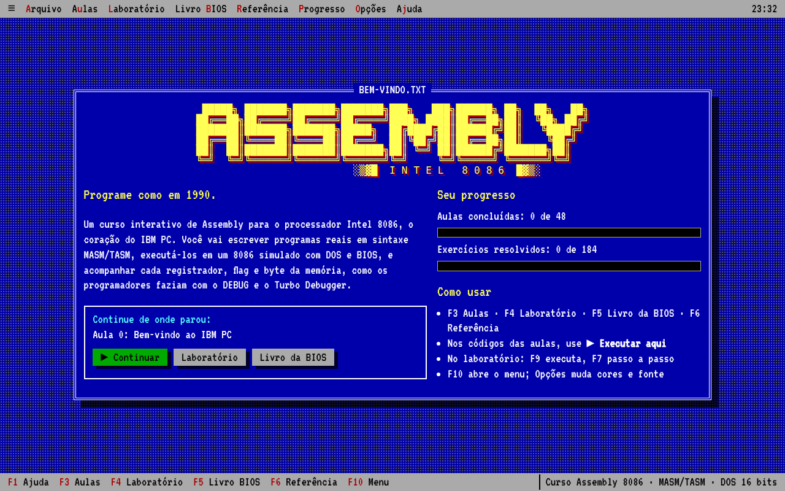
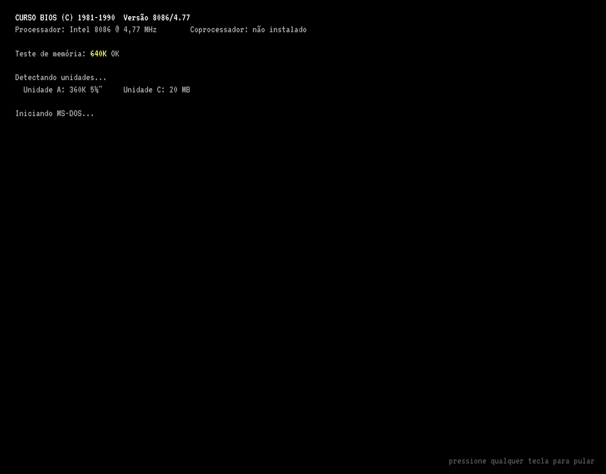
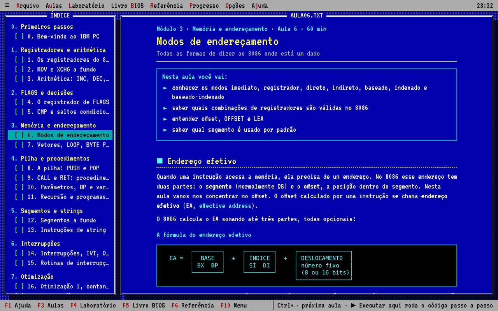
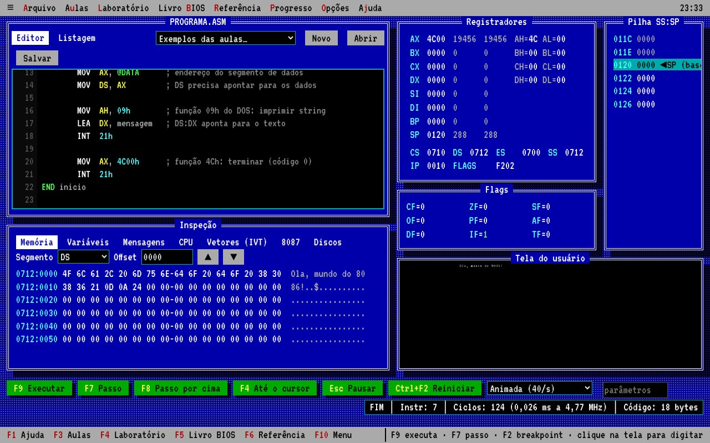
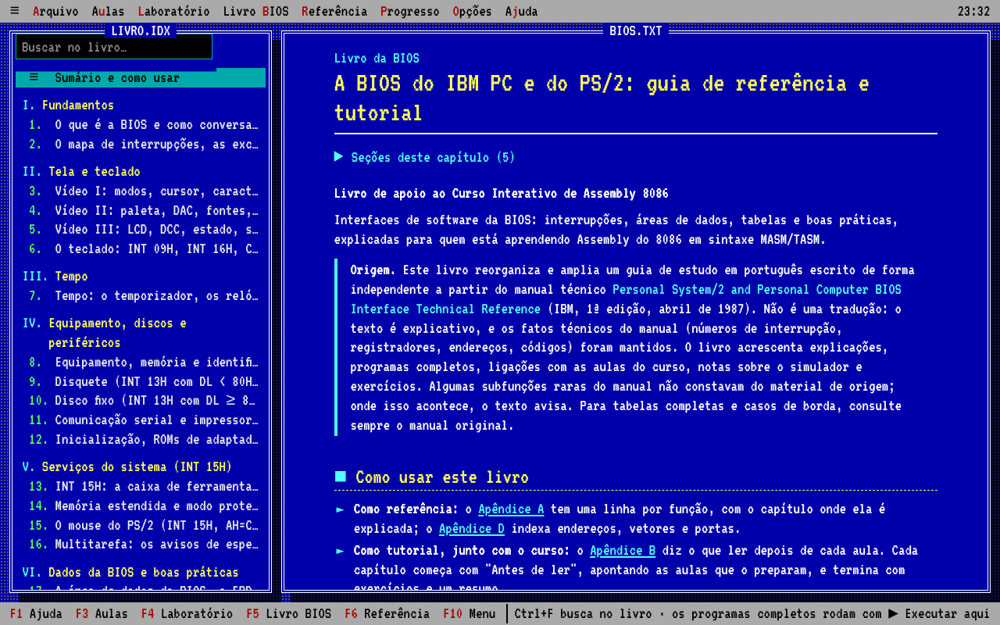
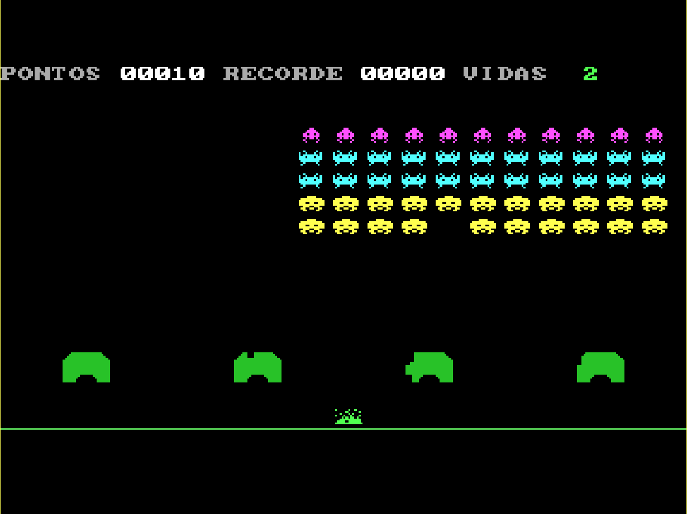
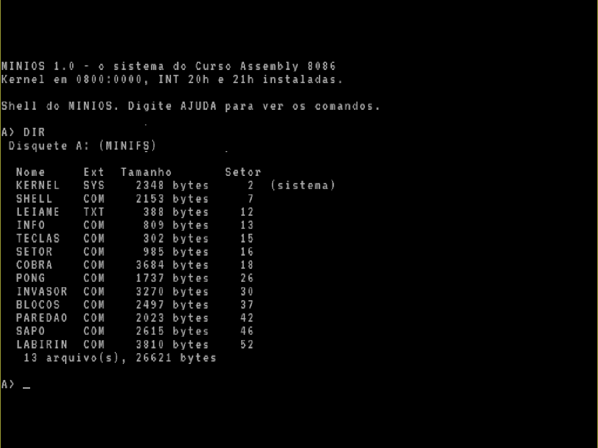
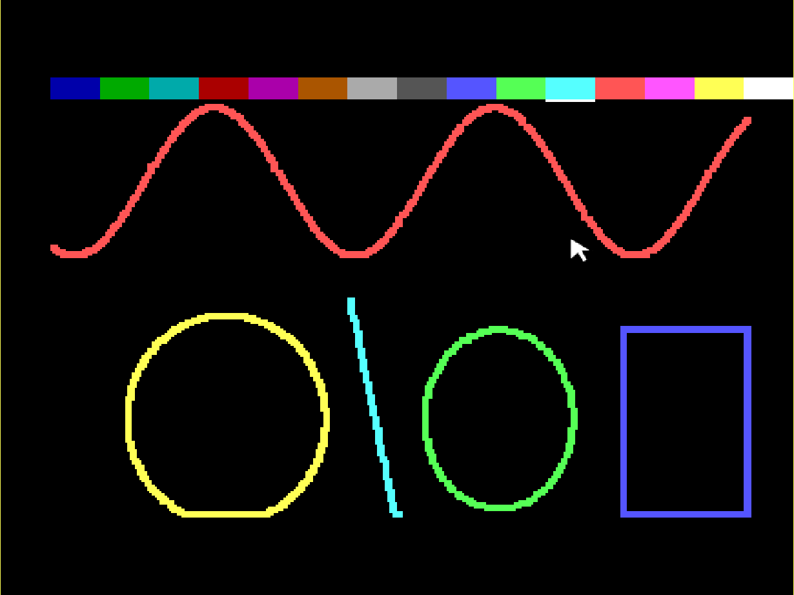

# Curso interativo de Assembly 8086

Um curso de Assembly do Intel 8086 em português, do básico ao avançado, com a cara e o espírito da programação DOS dos anos 90. Ele roda como aplicativo de desktop (Electron) ou direto no navegador.

**▶ [Rodar no navegador](https://gblnovaes.github.io/curso-assembly/)**: abre o curso completo direto pelo GitHub Pages, sem instalar nada. O progresso fica salvo no próprio navegador.

```
╔══════════════════════════════════════════════════════════════╗
║  48 aulas · 184 exercícios corrigidos automaticamente        ║
║  302 perguntas de quiz · 7 jogos · um sistema operacional    ║
╚══════════════════════════════════════════════════════════════╝
```

## Capturas de tela

| | |
|---|---|
|  |  |
| **Tela inicial**, com o progresso do aluno | **Boot da BIOS** ao abrir o curso |
|  |  |
| **Aula 6**: modos de endereçamento, com o índice ao lado | **Laboratório** no estilo Turbo Debugger: registradores, flags, pilha e memória |
|  |  |
| **Livro da BIOS** dentro do aplicativo | **Invasores do espaço** (aula 35), rodando no 8086 simulado |
|  |  |
| **MINIOS** (aula 44): o `DIR` do disquete depois do boot | **PINTA.ASM** (aula 47): pintura no modo 13h com o mouse pela `INT 33h` |

## O que tem dentro

- **Aulas detalhadas**, com diagramas em texto, notas sobre como funciona o 8086 por dentro, histórias da época ("Nos anos 90") e um resumo no fim.
- **Código executável em todas as aulas**: cada exemplo roda ali mesmo, passo a passo, ou abre no laboratório.
- **Exercícios corrigidos automaticamente**: o seu código é montado e executado contra vários testes (registradores, memória, saída na tela, pilha, ciclos e bytes). Cada exercício tem dicas graduais e solução de referência.
- **Quizzes** em todas as aulas, com explicação de cada resposta.
- **Sete jogos completos** no estilo dos anos 90 (cobra, pong, invasores do espaço, blocos que caem, paredão, sapo e labirinto com fantasmas), explicados linha a linha e jogáveis em tela grande, em tempo real, com o botão **▶ Jogar**.
- **Um sistema operacional do zero, o MINIOS**: setor de boot, kernel com a sua própria INT 21h, sistema de arquivos, EXEC, shell com comandos internos e utilitários. O botão **▶ Dar boot** liga um PC sem DOS e dá boot pelo disquete, e os sete jogos rodam nele.
- **Simuladores**: conversor de bases, registradores, calculadora de flags, segmento:offset, pilha, complemento de dois e comparação de ciclos e bytes entre dois trechos.
- **Laboratório (estilo Turbo Debugger)**: editor com realce, listagem com bytes e ciclos, registradores, flags, pilha, memória, variáveis, tabela de interrupções, pilha do 8087, disco C: virtual com os arquivos do aluno, linha de comando do programa, tela do usuário (texto 80×25 ou gráfico 320×200) e as teclas F2, F4, F7, F8 e F9.
- **Referência**: instruções do 8086 e do 8087, diretivas e macros do montador, INT 21h (incluindo arquivos, memória e PSP), BIOS, mouse (INT 33h), portas de E/S, mapa da memória, tabela de ciclos e tabela ASCII da página de código 437.
- **Livro da BIOS** (F5 ou menu Livro BIOS): os 22 capítulos e 4 apêndices de `livro-bios/` dentro do aplicativo, com busca no texto inteiro (Ctrl+F), sumário por partes, programas executáveis ali mesmo e links nos dois sentidos entre as aulas e os capítulos.
- **Progresso salvo** no computador do aluno, com exportação e importação.
- **Visual de época**: telas de texto com bordas duplas, temas Borland azul, preto, fósforo verde e âmbar, efeito CRT opcional, fonte VT323 e tela de boot da BIOS.

## O montador e o simulador

Tudo foi escrito do zero em JavaScript, sem dependências:

- **Montador** compatível com a sintaxe MASM/TASM: `.MODEL`, `.STACK`, `.DATA`, `.CODE`, `SEGMENT`/`ENDS`/`ASSUME`, `PROC NEAR/FAR`, `EQU`, `=`, `DUP`, `OFFSET`, `SEG`, `PTR`, rótulos locais `@@`, `EVEN`, macros (`MACRO`/`ENDM` com `LOCAL`, `&`, `%` e `EXITM`), repetições (`REPT`, `IRP`, `IRPC`), montagem condicional (`IF`, `IFE`, `IFDEF`, `IFNDEF`, `IFB`, `IFNB`, `IFIDN`, `IFDIF`, `ELSE`, `ENDIF`, com `EQ`/`NE`/`LT`/`LE`/`GT`/`GE`), estruturas (`STRUC`/`ENDS`, com `var.campo` e `[BX].campo`), `DD`/`DQ`/`DT` com números reais e as instruções do coprocessador 8087 (com o `WAIT` que o MASM insere). Gera o código de máquina real do 8086, com as mesmas codificações do MASM. Ele **recusa instruções e modos que não existem no 8086** (como `SHL AX,2`, `PUSH 5`, `IMUL AX,BX,3` e `[AX]`), explicando o porquê.
- **Simulador** do 8086 com 1 MB de memória, ciclos pela tabela da Intel (incluindo o custo do endereço efetivo e o de words em endereço ímpar), as particularidades do 8086 (`PUSH SP`, faixa do quociente do `IDIV`), IVT de verdade, PIC 8259, PIT 8253 (com a contagem e o alto-falante), teclado pela IRQ 1 e pela porta 60h, vídeo em modo texto (B800h) e VGA modo 13h (A000h, com a paleta do DAC e o retraço vertical), coprocessador 8087, os serviços mais usados do DOS (`INT 21h`: console, arquivos com handles num disco virtual, PSP e linha de comando, cadeia de MCBs e alocação de memória, programas residentes) e da BIOS (`INT 10h`, `13h`, `16h`, `19h`, `1Ah`), e um **driver de mouse** compatível com o da Microsoft (`INT 33h`: posição, botões, contagem de cliques, limites e a rotina de eventos da função 0Ch), que se usa com o mouse de verdade na tela do programa. Também liga **sem DOS**: um programa que é um disquete (setor de boot com 55AAh, ou vários arquivos num disquete MINIFS) é lido pela BIOS para 0000:7C00, e a `INT 13h` lê os outros setores. Depois de um `AH=31h`, o programa fica residente e o "prompt do DOS" continua rodando, com as interrupções instaladas funcionando.
- **Avisos didáticos** durante a execução: DS ainda apontando para o PSP, `LOOP` com CX = 0, estouro de pilha, `RET` sem `CALL`, execução caindo nos dados, divisão que estoura.

## Conteúdo

| Módulo | Aulas |
|--------|-------|
| 0. Primeiros passos | 0. Bem-vindo ao IBM PC |
| 1. Registradores e aritmética | 1. Os registradores do 8086 · 2. MOV e XCHG a fundo · 3. Aritmética: INC, DEC, ADD, SUB, ADC e SBB |
| 2. FLAGS e decisões | 4. O registrador de FLAGS · 5. CMP e saltos condicionais |
| 3. Memória e endereçamento | 6. Modos de endereçamento · 7. Vetores, LOOP, BYTE PTR e WORD PTR |
| 4. Pilha e procedimentos | 8. A pilha: PUSH e POP · 9. CALL e RET: procedimentos · 10. Parâmetros, BP e variáveis locais · 11. Recursão e programas DOS completos |
| 5. Segmentos e strings | 12. Segmentos a fundo · 13. Instruções de string |
| 6. Interrupções | 14. Interrupções, IVT, DOS e BIOS · 15. Rotinas de interrupção e o timer |
| 7. Otimização | 16. Contando ciclos e bytes · 17. Laços e memória |
| 8. Projetos, depuração e aritmética com sinal | 18. Analisador de vetores · 19. Menus e entrada de dados · 20. Depuração · 21. Calculadora de 32 bits · 22. Aritmética com sinal |
| 9. Gráficos VGA e modo 13h | 23. O modo gráfico 13h · 24. Paleta, retraço e animação |
| 10. Arquivos e o DOS por dentro | 25. Arquivos com handles · 26. PSP, linha de comando e memória |
| 11. Programas residentes (TSR) | 27. Programas residentes · 28. O teclado por dentro e TSRs com tecla de atalho |
| 12. Hardware direto e matemática | 29. O timer 8253 e o alto-falante · 30. BCD e ponto fixo · 31. O coprocessador 8087 |
| 13. Programação de jogos | 32. Fundamentos de jogos em DOS · 33. COBRA · 34. PONG · 35. Invasores do espaço · 36. Blocos que caem · 37. Paredão · 38. Sapo · 39. Labirinto |
| 14. Construindo um sistema operacional | 40. Do botão de ligar ao setor de boot · 41. O kernel e a sua própria INT 21h · 42. Arquivos e o EXEC · 43. O shell do MINIOS · 44. Utilitários e o disquete completo do MINIOS |
| 15. Macros, estruturas e mouse | 45. Macros e montagem condicional · 46. Estruturas: STRUC e campos · 47. O mouse: a INT 33h (com um programa de pintura) |

Para escrever novas aulas, veja o formato em [conteudo/LEIA-ME.md](conteudo/LEIA-ME.md).

### Trilha avançada (em construção)

A continuação do curso, a partir do módulo 16, fica em [conteudo-386/](conteudo-386/LEIA-ME.md), separada das aulas acima. Do módulo 17 em diante, os exemplos são escritos em NASM e rodam numa máquina 386 completa (`app/core/nasm.js` e `app/core/cpu386.js`), separada do simulador do 8086. A trilha fica escondida quando não está ativa: para vê-la, marque "Mostrar a trilha avançada" em **Opções** ou abra o app com `?avancado` na URL.

**Já prontos** (módulos 16 a 24, aulas 48 a 79):

- **Módulo 16 — Programas grandes** (aulas 48 a 53): o formato .EXE e o cabeçalho MZ, vários módulos com PUBLIC/EXTRN e o ligador, INCLUDE e bibliotecas, as convenções de chamada do C e do Pascal, e as ferramentas reais (MASM, TASM, DEBUG, DOSBox e a sintaxe do NASM). O montador do curso passou a ligar programas de vários arquivos; um código de um arquivo só é montado exatamente como antes.
- **Módulo 17 — O 186 e o 286** (aulas 54 a 56: as instruções novas, o modo protegido de 16 bits, a linha A20 e a HMA).
- **Módulo 18 — O 386 em modo real** (aulas 57 a 60: registradores de 32 bits, endereços com escala, FS e GS, as instruções novas e a detecção da CPU).
- **Módulo 19 — Entrando no modo protegido** (aulas 61 a 64: GDT, descritores, seletores, CR0 e o modelo plano).
- **Módulo 20 — Interrupções e exceções em 32 bits** (aulas 65 a 67: IDT, as exceções 0 a 31, o 8259 remapeado e a falha tripla).
- **Módulo 21 — Paginação** (aulas 68 a 70: CR3, diretório e tabelas de páginas, #PF e o kernel na metade alta).
- **Módulo 22 — Anéis e chamadas de sistema** (aulas 71 a 73: CPL, DPL e RPL, a TSS, IOPL e o modo usuário).
- **Módulo 23 — Multitarefa** (aulas 74 a 76: troca de tarefas por hardware e por software, escalonador e processos).
- **Módulo 24 — O modo virtual 8086** (aulas 77 a 79: um monitor v86 que roda programas do DOS dentro do seu kernel).

**Planejados** (módulos 25 a 28):

- **Módulo 25 — C para quem já sabe Assembly** (o Assembly que o compilador gera, cdecl, GCC cruzado e o ligador).
- **Módulo 26 — Um kernel de 32 bits estilo Unix** (ELF, drivers, FAT12, fork e exec, shell e pipes).
- **Módulo 27 — Desenho de sistemas operacionais** (DOS, Unix, Minix, Linux e NT: monolítico contra microkernel).
- **Módulo 28 — Depois do 386** (CPUID, APIC, modo de 64 bits e UEFI).

Em resumo: **32 aulas** prontas na trilha avançada (aula48 a aula79, módulos 16 a 24) e os módulos 25 a 28 em planejamento.

## Como executar

### Aplicativo de desktop (Electron)

Precisa do [Node.js](https://nodejs.org) 18 ou mais novo.

```
npm install
npm start
```

No aplicativo, **F11** liga a tela cheia.

### No navegador

A versão publicada está em **[https://gblnovaes.github.io/curso-assembly/](https://gblnovaes.github.io/curso-assembly/)** e é atualizada sozinha a cada push na `main` (workflow `.github/workflows/pages.yml`, que roda os testes e publica a pasta `app/`).

Para rodar localmente, abra `app/index.html` direto no navegador (funciona com `file://`), ou sirva a pasta:

```
npm run web
```

e acesse `http://localhost:8086`. Acrescente `?semboot` ao endereço para pular a tela de boot.

## Para quem vai mexer no curso

```
npm run conteudo    # recompila as aulas (conteudo/*.md -> app/conteudo.js), a trilha avançada (conteudo-386/*.md -> app/conteudo386.js) e o livro (livro-bios/*.md -> app/livro.js)
npm test            # testa o montador, o simulador e todas as aulas
```

O teste de conteúdo monta todos os exemplos executáveis (das aulas e do livro), confere que todo link do livro leva a uma aula ou capítulo que existe, que **a solução de cada exercício passa** e que **o código inicial de cada exercício falha**.

Estrutura:

```
app/
  index.html          página do aplicativo
  conteudo.js         gerado a partir de conteudo/ (não edite à mão)
  conteudo386.js      gerado a partir de conteudo-386/ (não edite à mão)
  livro.js            gerado a partir de livro-bios/ (não edite à mão)
  core/asm.js         montador 8086/8087 (MASM/TASM)
  core/cpu.js         simulador do 8086, do 8087 e do PC
  core/nasm.js        montador NASM da trilha avançada (386)
  core/cpu386.js      máquina 386 da trilha avançada: CPU, BIOS, DOS mínimo, PIC, PIT, teclado, disco
  core/fonte8x8.js    fonte 8x8 do modo gráfico (domínio público)
  ui/                 interface: aulas, laboratório, depurador, widgets, referência
  css/dos.css         temas e visual de modo texto
  fonts/              fonte VT323 (licença OFL)
conteudo/
  aulaNN-*.md         as aulas, em Markdown com blocos especiais
  modulos.json        a lista de módulos
  LEIA-ME.md          o formato das aulas
conteudo-386/         a trilha avançada (mesmo formato, módulos 16 em diante)
livro-bios/           o Livro da BIOS (capítulos e apêndices em Markdown)
tests/                testes do núcleo, do conteúdo e da máquina 386 (cenarios386/: conferidos com o Bochs)
tools/                build do conteúdo e comparações da máquina 386 com o QEMU e o Bochs
main.js               janela do Electron
```

## Licença

Código sob a licença MIT. A fonte VT323 é distribuída sob a SIL Open Font License (veja `app/fonts/VT323-OFL.txt`).
